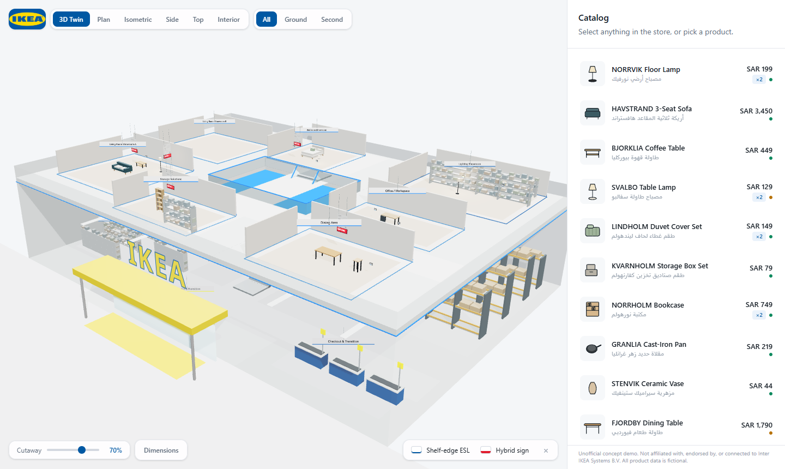

# IKEA ESL — Digital Twin

An interactive 3D concept prototype for **Electronic Shelf Labels** in a
two-floor retail store. One page: explore the store in 3D, click any product or
label, and read its full record in a side panel.

**[Open the live demo →](https://m-alghazali.github.io/ikea_esl/)** It runs in
the browser with nothing to install: drag to orbit, scroll to zoom, click a
label.



> **Disclaimer.** This is an unofficial concept prototype built to illustrate an
> ESL deployment. It is not affiliated with, endorsed by, or connected to Inter
> IKEA Systems B.V. All products, prices and stock figures are fictional.

---

## The idea

A retail store is a digital twin. Every shelf-edge price is a screen, and one
product record can drive labels in several physical places at once — change the
price once, and every label showing that product updates.

The prototype makes that visible rather than describing it.

## Two kinds of label

**Shelf-edge ESL** — a small e-paper tag clipped to the shelf lip. Carries the
product name in English and Arabic, price, promotional and previous price, an
illustration, a scannable QR, SKU, aisle, stock state and dimensions. A blue
strip on the housing marks it as powered; it brightens on hover and pulses when
selected.

**Hybrid showroom sign** — a large hanging *printed* information sheet whose red
price block at the bottom is a **screen**. The paper body is reprinted
seasonally; the price updates over the air. That split is the point of the
hybrid approach, so the two are built as separate surfaces — one matte, one lit.

## One product, several labels

Four products sit in two locations each. The clearest is the NORRHOLM Bookcase:
a flat-pack carton on a warehouse rack and an assembled unit in an upstairs
showroom, both driven by the same record. The NORRVIK Floor Lamp is labelled by
an ESL in the lamp section and by a hybrid sign in a living-room showroom —
same price, two very different labels.

Open the **Locations** tab on any of those and click a row: the camera flies to
that instance, so the claim is checkable in the scene rather than just asserted.

## The store

Ground floor is market hall (home accessories, kitchen, textiles, decor,
lighting), a self-serve warehouse with tall racking, a small furniture display
and a checkout row. Second floor is showrooms — two living rooms, a bedroom,
dining, office, storage solutions and the lamp section. An escalator runs
through a central atrium.

## Controls

| Action | How |
|---|---|
| Orbit | Left-drag |
| Pan | Right-drag |
| Zoom | Scroll |
| Select | Click a product, an ESL, or a hanging sign |
| Deselect | Click empty space |
| Camera | 3D Twin · Plan · Isometric · Side · Top · Interior |
| Open the building | Cutaway slider |
| Isolate a level | All / Ground / Second |
| Measurements | Dimensions toggle |

The **cutaway slider** does more than fade walls. At 0% the store is sealed. As
it opens, the roof lifts away and the entire upper floor rises, so both levels
stay solid and readable at once instead of one becoming a ghost. The escalator
stretches to keep the two plates connected.

## Running it

```bash
npm install
```

```bash
npm run dev
```

Then open http://localhost:5173.

```bash
npm run test     # data model and helpers
npm run build    # production bundle
```

## How it is built

React 19 · three.js · React Three Fiber · drei · Zustand · Tailwind CSS · Vite ·
Vitest.

No 3D assets are downloaded and nothing is fetched at runtime. The store is
composed entirely from three.js primitives with shared geometries and materials,
and every label is painted with Canvas2D and mapped onto a plane — which keeps
labels crisp, correctly occluded, cheap, and clickable by raycast. QR codes are
real and scannable.

```
src/data     product catalog, layout constants, derived placements
src/lib      formatting, camera presets, canvas painters, label textures
src/store    app state (selection, view, floor, cutaway)
src/scene    3D components — shell, fixtures, products, labels
src/ui       toolbar, floor filter, details panel, tabs
```

The seam that makes multi-location work is `src/data/placements.js`. It flattens
`PRODUCTS[].locations[]` into a single list: the 3D scene iterates *placements*,
the details panel iterates a *product's* locations, and both point at the same
records — so they cannot disagree.

## Scope

Deliberately not included: admin dashboards, label-management workflows, backend
CRUD, authentication, or operational tooling. This is a visual proof of concept.

All 16 products are mock data in `src/data/products.js`; edit that file and both
the 3D labels and the panel follow.

## Deployment

`main` holds the source. The published site lives on the `gh-pages` branch:

```bash
npm run deploy
```

That builds with the correct base path and pushes `dist/` to `gh-pages`.

## Licence

Source released under the MIT Licence — see [LICENSE](LICENSE). The trademarks
and logo referenced in this prototype remain the property of their respective
owners and are not covered by that licence.
